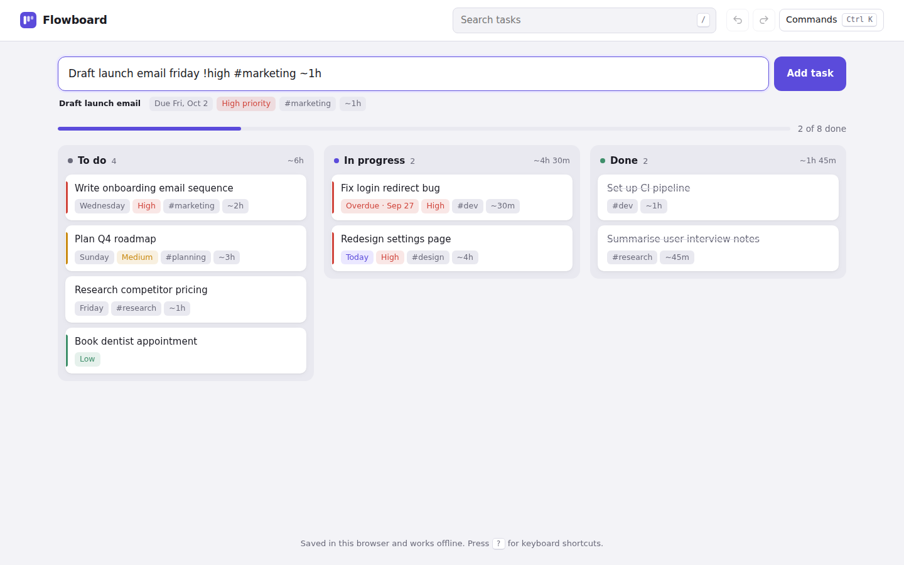

# Flowboard

A keyboard-first task board. Type tasks in plain English and Flowboard picks out the due date, priority, tags and time estimate as you type.

**Live demo:** https://flowboard-yourname.vercel.app ← update after deploying



## Features
- **Natural-language input:** `Draft launch email friday !high #marketing ~1h` becomes a task due Friday, high priority, tagged marketing, estimated at 1 hour. Supports today, tomorrow, weekdays, "next week", "in 3 days", "oct 12", "12 dec" and ISO dates.
- Live preview of what will be parsed, before you press Enter
- Drag and drop between columns with mouse, pen or touch (long-press on phones)
- **Command palette** (Ctrl/Cmd + K) with fuzzy search across commands and tasks
- Full keyboard control: arrows to move between tasks, Shift + arrows to move a task, Enter to edit, Delete to remove
- Undo and redo for every change (Ctrl+Z / Ctrl+Shift+Z)
- Filter by tag, priority or search text; per-column time totals; progress bar
- **Works offline** as an installable app (PWA with a service worker)
- Data saved in the browser; export and import the board as JSON
- Light and dark themes

## Tech
Vanilla JavaScript, Pointer Events, HTML `<dialog>`, localStorage, Service Worker, Web App Manifest. No framework, no build step, no backend.

## Tests
The parser is a standalone module you can test with Node:
```bash
node -e "const {parse}=require('./parser.js'); console.log(parse('Pay rent oct 1 !high ~15m'))"
```

## Run locally
```bash
npx serve .
```
